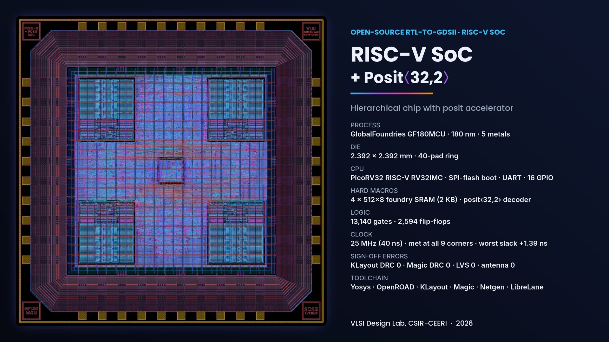

# dec_PD — Posit⟨32,2⟩ decoder: from VHDL to silicon layout on open PDKs

This repository takes `Decoder_32_2.vhd` (a posit⟨32,2⟩ decoder) through a
complete open-source RTL-to-GDSII flow. It produces three layouts.

| Design | PDK / flow | Description |
|---|---|---|
| **v2 — RISC-V SoC** (main) | GF180MCU, LibreLane Chip flow, hierarchical | PicoRV32 RV32IMC, 2 KB SRAM from four foundry SRAM macros, posit decoder as a hard macro on the CPU bus, 40-pad ring, 2.392 mm die |
| v1 — decoder chip | GF180MCU, LibreLane Chip flow | Decoder with 70 direct I/O pads in an 88-pad ring, 2.987 mm die (pad-limited) |
| Core macro | SKY130A, LibreLane Classic flow | Decoder hardened as a 110 µm × 110 µm macro |

## v2 — RISC-V SoC with posit accelerator



**Sign-off (GF180MCU, LibreLane):** KLayout DRC 0 · Magic DRC 0 · LVS 0 ·
antenna 0 · setup and hold met at all nine corners at 25 MHz (worst setup
slack +1.39 ns). Remaining warnings: max-slew violations at the slow-slow
corner (125 °C, 4.5 V) on high-fanout nets.

### Architecture

```
            ┌──────────────────────── 40-pad ring (GF180 fd_io) ───────────────────────┐
  SPI flash ─┤ spimemio ─┐                                                            │
  UART      ─┤ simpleuart├── PicoRV32 (RV32IMC) ── bus ──┬── SRAM 2 KB (4 × 512×8 macros) │
  GPIO[15:0]─┤ GPIO regs ┘                               └── posit⟨32,2⟩ decoder macro    │
            └──────────────────────────────────────────────────────────────────────────┘
```

### Memory map

| Address | Register | Access |
|---|---|---|
| `0x0000_0000`–`0x0000_07FF` | SRAM (stack and data) | rw |
| `0x0010_0000`– | SPI flash, execute in place | r |
| `0x0200_0000` / `0x0200_0004` / `0x0200_0008` | flash config / UART divider / UART data | rw |
| `0x0300_0000` | `GPIO_OUT` | rw |
| `0x0300_0004` | `GPIO_OE` (1 = drive pad) | rw |
| `0x0300_0008` | `GPIO_IN` | r |
| `0x0300_0010` | `POSIT_IN` (32-bit operand) | rw |
| `0x0300_0014` | `POSIT_FLD` = `{inf, sign, exp[1:0], reg[5:0]}` | r |
| `0x0300_0018` | `POSIT_MANT` = `mantissa[27:0]` | r |

### Hierarchical flow

1. **Stage 1 — `make macro`:** hardens `posit_decoder_32_2` as a 200 µm × 200 µm
   GF180 macro (Metal1–Metal4, vertical Metal4 power straps). The views are
   exported to `ip/posit_macro/`.
2. **Stage 2 — `make soc`:** implements `soc_chip_top`. The four SRAM macros
   sit in the core corners with their pins facing the centre, and the decoder
   macro sits at the centre. Each macro is LVS-checked during its own
   hardening and treated as a black box at the top level.

### Verification

| Check | Command | What it shows |
|---|---|---|
| VHDL ≡ Verilog | `make equiv` | Yosys + GHDL SAT miter over all 2³² inputs, plus 500 k random vectors |
| Firmware | `make firmware` | Self-test for RV32IMC (`firmware/main.c`), executed from SPI flash |
| Chip-level simulation | `make soc-sim` | Pad models, SRAM models, PicoRV32 booting from a flash model; the firmware tests SRAM word/byte access, MUL/DIV and 52 posit vectors and writes `0xA5A5` to GPIO on success |

The simulation runs twice: once with the foundry SRAM model (5 MHz clock,
1 ns simulation-only input delay that stands in for real hold margin) and once
with a datasheet functional SRAM model at 25 MHz.

## Repository layout

| Path | Purpose |
|---|---|
| `Decoder_32_2.vhd` | Original VHDL source (unchanged) |
| `src/posit_decoder_32_2.v` | Verilog translation used for synthesis |
| `src/soc/` | SoC RTL: `soc_chip_top.v` (generated pad ring), `soc_top.v`, `soc_sram_2kb.v`, `picosoc_gf180.v` |
| `src/soc/vendor/` | PicoRV32 / PicoSoC, unmodified (ISC license) |
| `src/chip_top.v` | v1 pad ring (generated) |
| `firmware/` | Self-test firmware and test-vector generator |
| `verif/` | Equivalence proof and SoC testbench |
| `ip/` | Die-art badges and the hardened posit macro views |
| `librelane/soc/`, `librelane/posit_macro/` | v2 flow configuration |
| `librelane/config.yaml`, `librelane/pads.yaml` | v1 flow configuration |
| `librelane/sky130/` | SKY130 macro configuration |
| `scripts/` | Generators, mask renderer, compositor and showcase-card builder |
| `.github/workflows/layout.yml` | Cloud run; results land on the `results-*` branches |

## Running locally

```
nix develop
make clone-pdk
make equiv
make firmware      # needs riscv64-unknown-elf-gcc
make soc-sim
make macro         # stage 1
make soc           # stage 2
```

## Credits and licenses

* PicoRV32 / PicoSoC — Claire Xenia Wolf and contributors, ISC license.
* Nix environment, PDN script and render palette — wafer.space
  gf180mcu-project-template, Apache-2.0 (`LICENSE.template-apache2`).
* GF180MCU PDK, I/O cells and SRAM macros — GlobalFoundries / Google, Apache-2.0.
